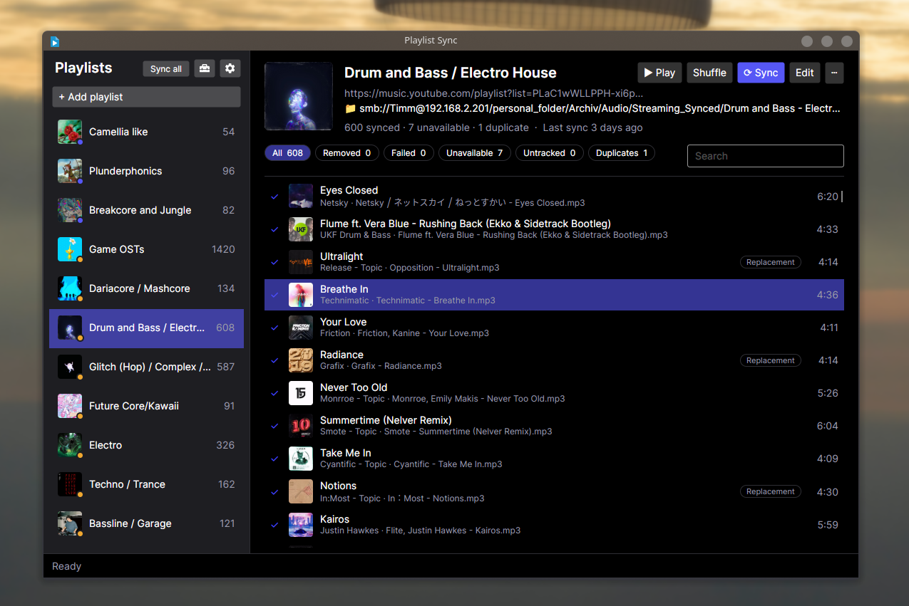

# Playlist Sync

A native desktop app that keeps local folders in sync with YouTube / YouTube Music playlists.
Press **Sync** and every track of the playlist is downloaded as an audio file with
[yt-dlp](https://github.com/yt-dlp/yt-dlp) and [ffmpeg](https://ffmpeg.org). Tracks that disappear
from the remote playlist are highlighted, never deleted automatically.



Runs on Linux (Arch is the primary target) and Windows. Built with C# / .NET 10 and Avalonia UI.

## Requirements

| Tool | Needed for | Notes |
|---|---|---|
| [.NET 10 SDK](https://dotnet.microsoft.com/download/dotnet/10.0) | building | Not needed to *run* a release build, which is self-contained |
| `yt-dlp` | running | Must be on `PATH`, or set its path in Settings → Tools |
| `ffmpeg` (+ `ffprobe`) | running | Audio conversion, metadata and cover embedding |
| `deno` (or `node` / `bun`) | running, recommended | JS runtime yt-dlp needs for full YouTube support |

## Quick start (Linux)

```bash
scripts/setup.sh                              # install dependencies, build, run tests
dotnet run --project src/PlaylistSync.App     # start the app
```

`scripts/setup.sh` detects your package manager (pacman, apt, dnf, zypper) and installs whatever is
missing. If no .NET 10 SDK package is available it falls back to Microsoft's `dotnet-install.sh`
(into `~/.dotnet`, no root needed). Options:

| Option | Effect |
|---|---|
| `--no-deps` | Skip dependency installation; only build and test |
| `--no-tests` | Don't run the unit tests |
| `--no-deno` | Don't install deno |
| `-c Release` | Build the Release configuration (default: Debug) |

## Building manually

Arch:

```bash
sudo pacman -S dotnet-sdk yt-dlp ffmpeg deno
```

Debian / Ubuntu: `sudo apt install dotnet-sdk-10.0 ffmpeg yt-dlp` (the distro's `yt-dlp` is often
outdated; `pipx install yt-dlp` gets the current one).
Fedora: `sudo dnf install dotnet-sdk-10.0 yt-dlp ffmpeg` (ffmpeg needs RPM Fusion).

Windows (PowerShell):

```powershell
winget install Microsoft.DotNet.SDK.10 yt-dlp.yt-dlp Gyan.FFmpeg DenoLand.Deno
```

Then, on any platform:

```bash
dotnet build                                  # build everything
dotnet test                                   # run the unit tests
dotnet run --project src/PlaylistSync.App     # start the app
```

To run only some tests (xunit v3 on Microsoft.Testing.Platform, so the old `--filter` syntax doesn't apply):

```bash
dotnet test -- --filter-class "*SyncPlannerTests"
dotnet test -- --filter-method "*Round_trip*"
```

Logs are written to `~/.local/share/playlist-sync/logs/` on Linux and `%LOCALAPPDATA%\PlaylistSync\logs\` on Windows.

## Release packages

```bash
scripts/release.sh
```

This runs the tests, then publishes self-contained single-file binaries (no .NET install needed on the
target machine) and packages them into `dist/`:

```
dist/playlist-sync-<version>-linux-x64.tar.gz
dist/playlist-sync-<version>-win-x64.zip
dist/SHA256SUMS
```

The Windows build is cross-compiled, so both packages can be made on Linux. The version comes from
`<Version>` in `Directory.Build.props`. Options:

| Option | Effect |
|---|---|
| `--version X.Y.Z` | Override the version |
| `--rid <rid>` | Build only this runtime (repeatable), e.g. `--rid linux-x64 --rid linux-arm64` |
| `--skip-tests` | Don't run the tests first |

yt-dlp, ffmpeg and deno are **not** bundled; install them on the target machine (or let the app download
them). To install a Linux build:

```bash
tar xzf playlist-sync-<version>-linux-x64.tar.gz
./playlist-sync-<version>-linux-x64/playlist-sync
```

To publish a single binary by hand:

```bash
dotnet publish src/PlaylistSync.App -c Release -r linux-x64 --self-contained -p:PublishSingleFile=true -o publish/linux-x64
```

## Project layout

```
src/PlaylistSync.Core/        models, storage, yt-dlp integration, sync logic (no UI)
src/PlaylistSync.App/         Avalonia views and view models
tests/PlaylistSync.Core.Tests/ unit tests
scripts/                      setup.sh, release.sh
packaging/                    AppImage, PKGBUILD, .desktop, Windows scripts (planned)
```

The implementation plan and milestone status are in [`PLAN.md`](PLAN.md).
